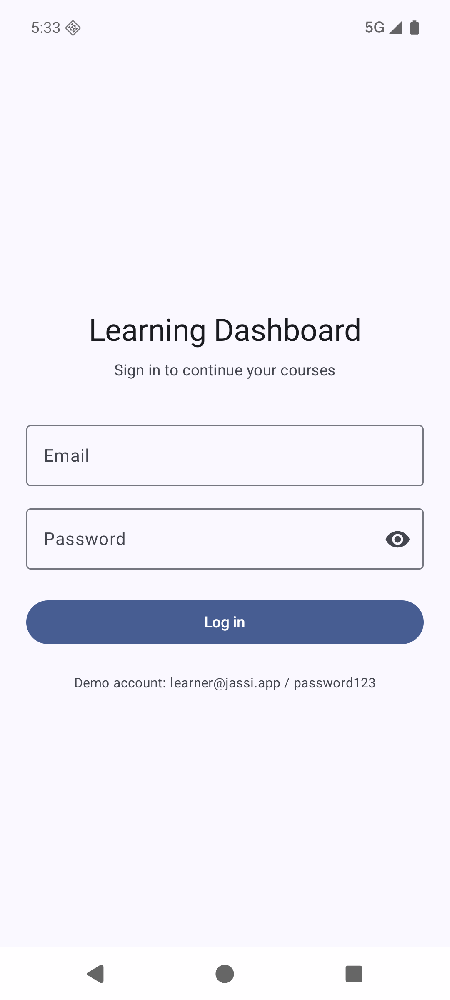
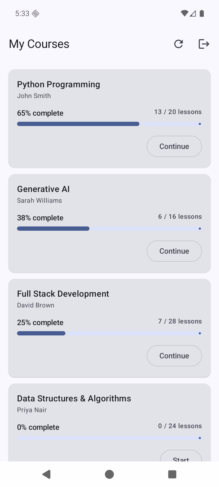
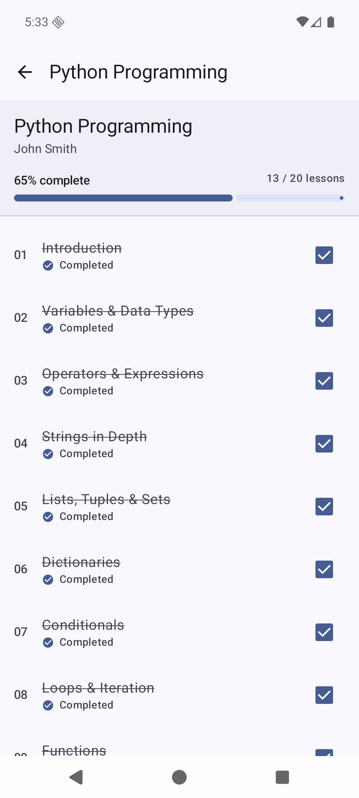
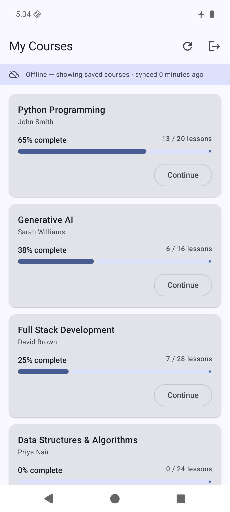

# Learning Dashboard

Android · Kotlin · Jetpack Compose · MVVM + Clean Architecture · offline-first

**Demo account:** `learner@jassi.app` / `password123` (shown on the login screen)

| Login | Dashboard | Details | Offline |
|---|---|---|---|
|  |  |  |  |

```bash
./gradlew assembleDebug        # APK -> app/build/outputs/apk/debug/ (also ./learning-dashboard-debug.apk)
./gradlew testDebugUnitTest    # 34 unit tests, all passing
```

Verified on a Pixel 8 / API 36 emulator: login validation → loading → error → dashboard →
details → lesson completion → airplane mode → cached data → retry.

**The "API".** `MockApiInterceptor` sits at the OkHttp transport layer and serves
`app/src/main/assets/courses.json`, so Retrofit, kotlinx.serialization, error mapping, the
Room sync and every ViewModel above it run the real production code path — only the socket
is replaced. It is connectivity-aware, so airplane mode throws the same `IOException` a real
socket would and the offline behaviour below is genuine, not simulated. To point at a real
server instead, host `api-fixtures/courses.json` anywhere and set in `gradle.properties`:

```properties
useMockApi=false
coursesApiBaseUrl=https://raw.githubusercontent.com/<you>/<repo>/main/api-fixtures/
```

---

## 1. Architecture

MVVM with Clean Architecture layering: `presentation → domain → data`, dependencies pointing
inward only, wired by Hilt. The domain layer is pure Kotlin — models, use cases, validation
and `ProgressCalculator` have no Android imports, so the business rules are testable in
milliseconds without an emulator.

Two decisions do most of the work:

- **The database is the single source of truth.** Repository reads are cold `Flow`s from Room
  that never touch the network; `refreshCourses()` is the only call that does, and all it does
  is write to Room. There is no "if offline, read the cache" branch anywhere in the app,
  because reads were never going to the network. Offline support falls out of the design
  rather than being bolted on.
- **UI state is derived, never assigned.** `DashboardViewModel` combines three inputs —
  cached courses, sync status, connectivity — into one sealed `DashboardUiState`. It cannot
  produce a state that contradicts the cache, and the four required states (loading, success,
  empty, failure) are exhaustive `when` branches rather than a pile of booleans.

Repository methods return `AppResult<T>` over a closed `DataError` taxonomy instead of
throwing, so a failed sync is a state the UI renders rather than an exception someone has to
remember to catch. Exceptions become `DataError` in exactly one place (`ErrorMapper.kt`).

## 2. Offline Support

Room, two tables (`courses`, `lessons`) with a cascading foreign key, lesson counts aggregated
in SQL so the dashboard is O(courses) rather than loading every lesson row to compute a
percentage. A refresh applies one snapshot atomically in a `@Transaction`.

The rule that matters is **who owns which column**: the server owns course metadata and the
syllabus, the device owns `isCompleted`. A plain upsert of the lesson rows would silently
reset every lesson the learner had just ticked on each sync, so `CourseDao.syncCourses()`
inserts new lessons with `IGNORE` and updates only the content columns of rows that already
exist. There is a test for exactly this. Rows absent from the snapshot are pruned so an
unenrolment propagates instead of leaving a ghost course forever.

Writes are local-first: ticking a lesson writes to Room, the `Flow` re-emits and both screens
update, so it works with no connectivity and nothing needs rolling back.

## 3. Security

Here, the token is encrypted with AES-256-GCM under a non-extractable Android Keystore key
(`KeystoreCrypto`) and stored in private `SharedPreferences`; the key never enters process
memory and is hardware-backed on most devices. `androidx.security:security-crypto` is
deliberately not used — Google deprecated it with no drop-in replacement. `allowBackup` is
off, tokens are never logged, and HTTP body logging is debug-only.

In production I would additionally: keep the **short-lived access token in memory only** and
persist only the **refresh token** at rest; put refresh behind an OkHttp `Authenticator` with
single-flight so a 401 storm cannot fan out; bind the key to biometric/device-credential
auth (`setUserAuthenticationRequired`) for anything sensitive; and add certificate pinning.
The real answer is that the token should be as short-lived and as revocable as possible — the
storage mechanism is the second line of defence, not the first.

## 4. Scale — 1M users, hundreds of courses

1. **Paginate and split the endpoints.** One bulk payload with every syllabus is fine for five
   courses and indefensible for hundreds. `GET /courses` paged (Paging 3 + `RemoteMediator`
   over Room), syllabus fetched per course on demand.
2. **Make sync incremental and cheap.** `If-None-Match`/`updated_since` so an unchanged
   catalogue costs a 304, not a full payload — at 1M users that is the difference between a
   CDN bill and an outage.
3. **Make completions durable, not fire-and-forget.** Queue each completion in an outbox table
   and drain it with WorkManager under network constraints, with idempotency keys and
   last-write-wins on a server timestamp. Today a completion is local-only; at scale it has to
   survive process death and reach the server exactly once.
4. **Observability before features.** Crash reporting, ANR tracking, and timing on sync and
   cold start, sliced by release — you cannot operate at that size on bug reports.
5. **Guard the regressions that matter.** Baseline Profiles and a macrobenchmark for cold
   start, R8 already on for release, plus screenshot tests on the four dashboard states so a
   refactor cannot quietly break the empty or error path.

## 5. Second platform — iOS/macOS

Same architecture, different vocabulary. SwiftUI for the views; `@Observable` view models
holding one `enum` state per screen, mirroring the sealed interfaces here. Swift Concurrency
replaces coroutines — `AsyncStream`/`AsyncSequence` for the Room `Flow`s, `async throws` for
the network, `Task` and structured cancellation where `viewModelScope` is used.

The local store becomes SwiftData (or GRDB where precise SQL matters — the aggregate-count
query and the insert-or-ignore sync rule both want real SQL, which is a point in GRDB's
favour). `URLSession` with `Codable` replaces Retrofit + kotlinx.serialization; the Keystore
becomes the Keychain with `kSecAttrAccessibleAfterFirstUnlockThisDeviceOnly`, which gives the
same hardware-backed, non-exportable guarantee. Protocol-based DI via initialiser injection
replaces Hilt; a DI framework is not worth it at this size.

The layering transfers unchanged because the domain layer has no Android in it. If both
platforms were a real commitment I would evaluate Kotlin Multiplatform for exactly that
layer — domain models, progress calculation, the repository contract and the Room/SQLDelight
cache — leaving only the UI native. That is roughly the 40% of this codebase that is pure
logic, and it is the part where two platforms drifting apart actually hurts.

---

### Testing

34 unit tests, all passing. The two that earn their keep:

- `CourseRepositoryImplTest` runs against a real in-memory SQLite database (Robolectric),
  not a mocked DAO, because the behaviour under test lives in the SQL. It covers the offline
  contract end to end: cache, serve-while-failing, prune, and the local-completion-survives-
  refresh rule.
- `DashboardViewModelTest` pins the state machine, including the distinction between a fatal
  failure and a recoverable one. It caught a real bug while I was writing it: `syncStatus`
  started as `InFlight`, so the in-flight guard in `refresh()` rejected the very first sync
  from `init {}` and the dashboard would have hung on "Loading" forever on a cold start.

### Trade-offs taken knowingly

UI strings are inline rather than in `strings.xml` (localisation would want resources);
there are no instrumentation or screenshot tests; a completion is not yet queued for upload;
and the course list is a single bulk endpoint. Each is called out in the code where it lives.
